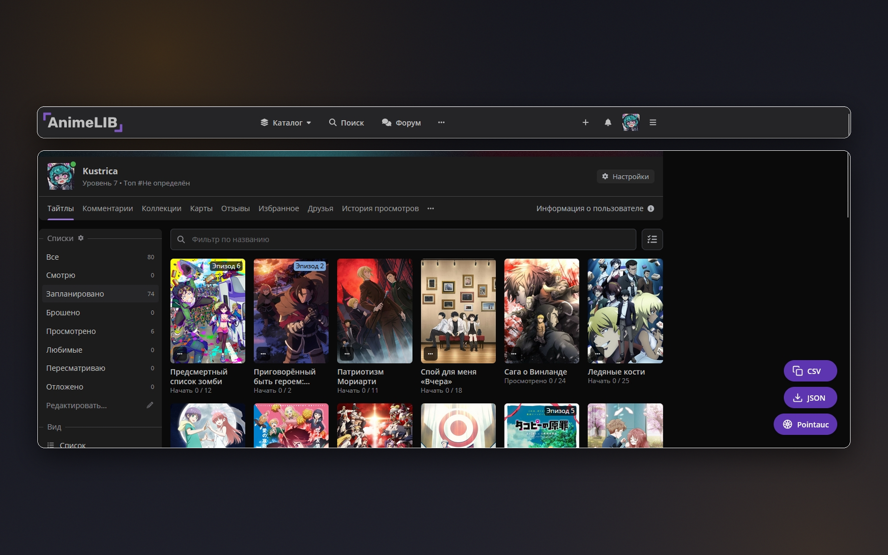
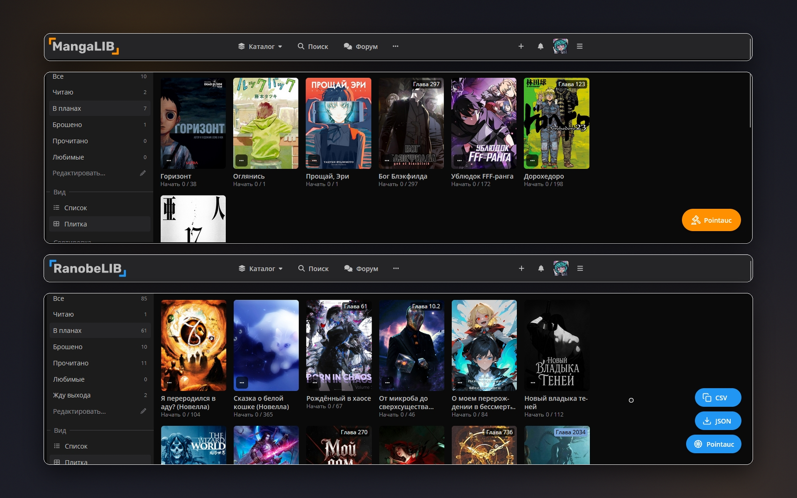
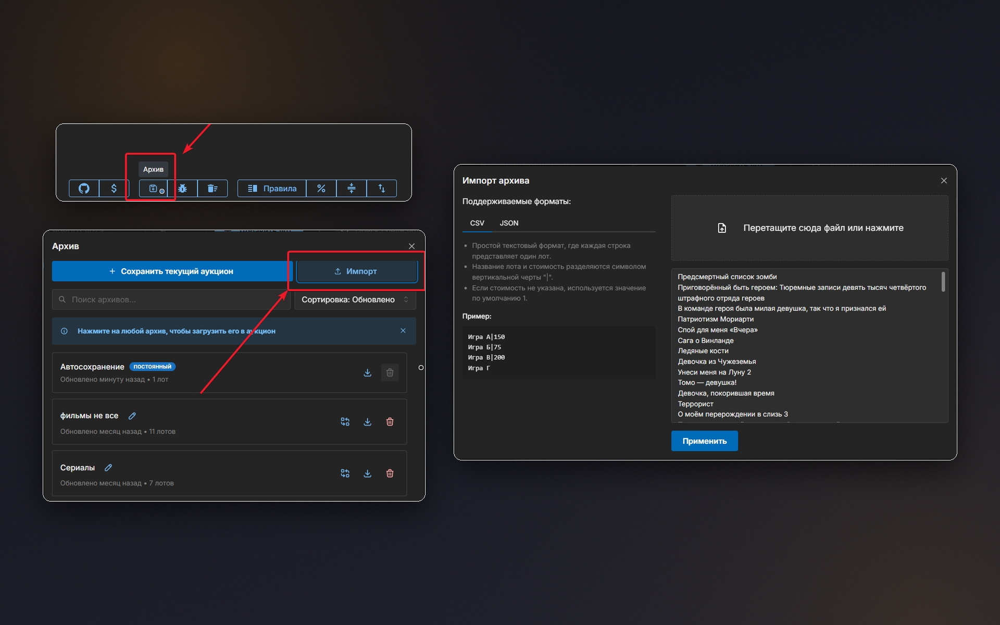
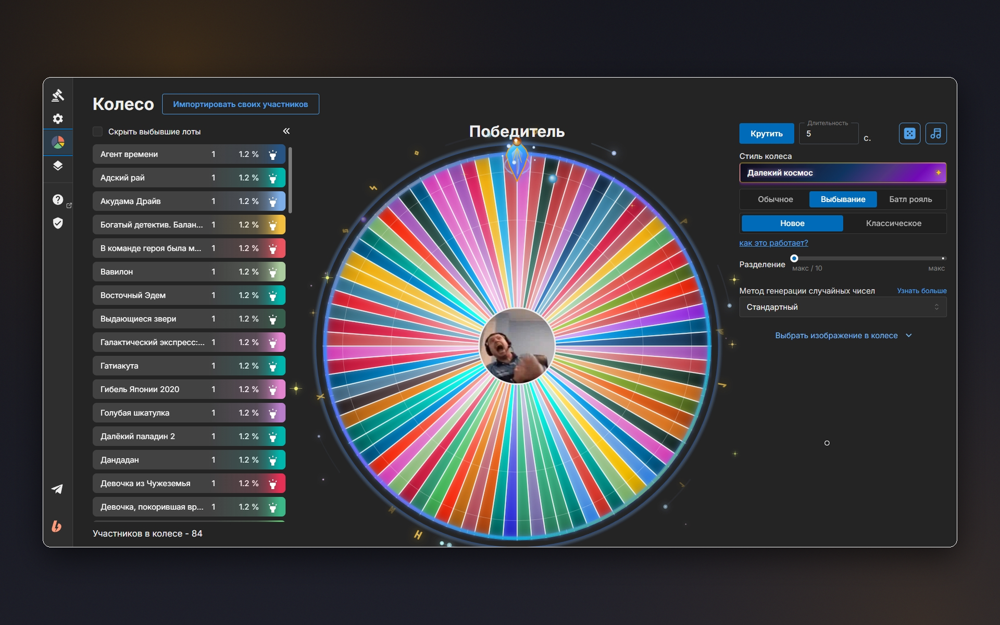

# AnimeLib to Pointauc

Export your anime, manga and ranobe lists from the Lib network (AnimeLib, MangaLib, RanobeLib, HentaiLib, SlashLib) straight into a format that [Pointauc](https://pointauc.com/) auctions can import – no manual copying.

**[Install from addons.mozilla.org](https://addons.mozilla.org/firefox/addon/animelib-to-pointauc/)**

## Screenshots

| | |
|:---:|:---:|
|  Export buttons appear right on your AnimeLib list: copy titles as CSV, download a JSON file, or open the Pointauc wheel. |  Works across the Lib network – MangaLib, RanobeLib, HentaiLib and SlashLib – with buttons in each site's colors. |
|  Import into Pointauc in three steps: open Archive, click Import, then drop the file or paste the list and apply. |  Your whole list lands on the Pointauc wheel, ready to spin. |

## Features
- **One-click export** – a floating menu appears on your list page: copy titles as **CSV** to the clipboard, download a **JSON** file, or open the **Pointauc** wheel.
- **Works across the Lib network** – AnimeLib, MangaLib, RanobeLib, HentaiLib and SlashLib, with buttons in each site's colors.
- **Formats** – JSON (the main Pointauc format) and CSV (easy to edit, back up or paste).

## How to import into Pointauc
1. Open [pointauc.com](https://pointauc.com/) and click **Archive** in the bottom toolbar.
2. Click **Import**.
3. Drop the exported file or paste the CSV list, then click **Apply**. Your titles show up on the wheel.

## Technical details
- Manifest V3, a lightweight content script that runs only on supported domains
- No background load when it's not in use
- **No data collection**, tracking, or analytics: everything runs locally

## Localization
Translated into **19 languages**: English, Spanish, German, French, Russian, Belarusian, Chinese (Simplified and Traditional), Japanese, Portuguese, Italian, Korean, Polish, Dutch, Turkish, Ukrainian, Indonesian, Arabic, and Vietnamese.

## Support
[Telegram](https://t.me/kustric) · [Ko-fi](https://ko-fi.com/kustrica) · [Patreon](https://www.patreon.com/kustrica) · [Boosty](https://boosty.to/kustrica)
